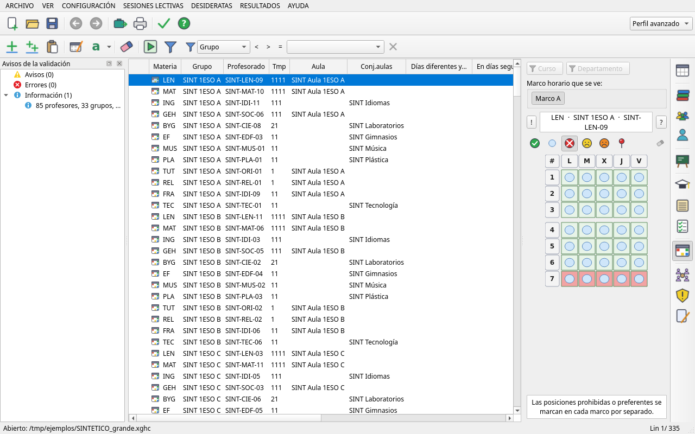
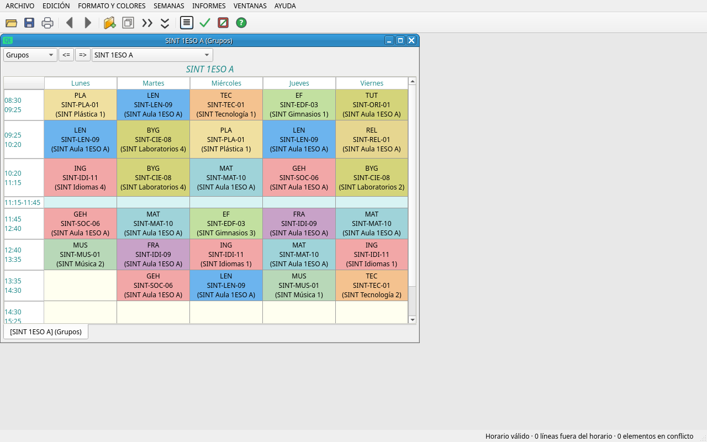
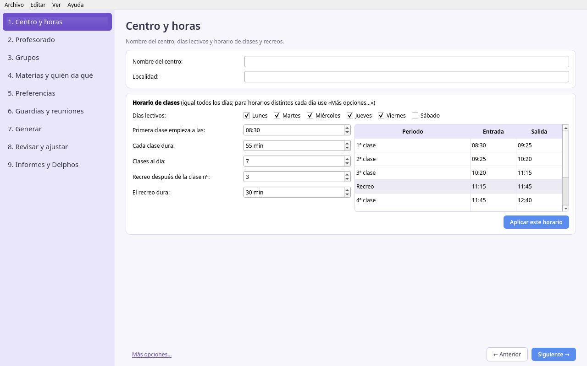

# ClaustrApp

**Los horarios de su centro, resueltos en minutos y no en semanas.** ClaustrApp es un planificador de horarios escolares
libre y gratuito para institutos: encaja profesorado, grupos, aulas y guardias por usted, respeta las preferencias que
importan y le deja dar el último retoque. Compatible con archivos XML-GHC.

> ClaustrApp es un proyecto independiente. **No es un producto oficial** ni está afiliado a los autores de ningún otro
> programa de horarios. «XML-GHC» se nombra solo para indicar con qué formato de archivo es compatible: el esquema
> `GHCFile.xsd` lo publican sus autores bajo LGPLv3.

Interfaz en español para Windows 10/11; desde el código también funciona en Linux. Los datos del centro se guardan solo
en los archivos que usted elige (`.xghc` para los datos y `.lphr` para cada horario calculado); el programa nunca
sobrescribe el archivo original. Las preferencias de la ventana se guardan en la configuración del usuario
(en Windows, en el registro, `HKCU\Software\LomoXSoft\ClaustrApp`). **No se conecta a Internet**: todo, incluido el
cálculo del horario, se hace en el propio ordenador.

Estado: **versión temprana (0.0.x)**. Trabaje siempre con copias de sus archivos.



**Contenido:** [Funciones](#funciones) · [Requisitos](#requisitos) · [Instalar y actualizar](#instalar-y-actualizar) ·
[Datos y copias de seguridad](#datos-y-copias-de-seguridad) · [Desarrollo](#ejecutar-desde-el-código-desarrollo) ·
[Pruebas](#pruebas) · [Construir el instalador](#construir-el-instalador-windows) · [Estructura](#estructura) ·
[Limitaciones y planes](#limitaciones-y-planes) · [Apoyar el proyecto](#apoyar-el-proyecto) · [Licencia](#licencia)

## Funciones

- **Datos del centro**: marcos horarios, materias, grupos, profesorado, aulas y conjuntos de aulas, sesiones, reuniones
  y guardias. Lee y escribe archivos **XML-GHC** (`.xghc`).
- **Condiciones y preferencias**: plantillas «puede / mejor no / no puede», días distintos, horas seguidas, máximos y
  mínimos diarios, huecos, permanencia, mañanas o tardes libres, aulas preferentes…
- **Cálculo del horario** con un motor de optimización (OR-Tools CP-SAT) en un proceso aparte: se puede pausar y
  reanudar, guarda cada resultado y un **comprobador independiente** revisa que se cumplan las condiciones.
- **Depurador de condiciones**: si no sale un horario completo, ayuda a localizar qué condiciones lo impiden.
- **Editor del resultado**: mover, intercambiar y recolocar clases, con colores para lo que se puede, lo que tiene
  avisos y lo que no se puede.
- **Versión sencilla**: un asistente paso a paso (centro y horas, profesorado, grupos, materias, preferencias, guardias,
  generar, revisar e informes) con explicaciones en lenguaje llano.
- **Informes en PDF**: horarios por grupo, profesor y aula, guardias, ausencias y resúmenes.
- **DELPHOS** (Castilla-La Mancha): importar datos y exportar el horario.

Capturas (con datos inventados, prefijo `SINT`) en [`capturas/`](capturas/):

| Editor del resultado | Versión sencilla |
| --- | --- |
|  |  |

## Requisitos

- Windows 10 o Windows 11 de **64 bits** (o Linux, ejecutando desde el código).
- 4 GB de RAM como mínimo; 8 GB recomendados para centros grandes.
- Para ejecutar desde el código: Python 3.11 o posterior.

## Instalar y actualizar

El ejecutable de Windows **llegará pronto** en [Releases](https://github.com/LomoXSoft/ClaustrApp/releases/latest).
Será una carpeta portable: se descomprime y se abre `ClaustrApp.exe`, sin instalar nada. Para actualizar bastará con
sustituir la carpeta; sus archivos `.xghc` y `.lphr` no se tocan.

Mientras tanto, puede [ejecutarlo desde el código](#ejecutar-desde-el-código-desarrollo).

## Datos y copias de seguridad

- Todo el trabajo está en sus archivos `.xghc` (datos) y `.lphr` (horarios calculados). Para hacer una copia de
  seguridad, copie esos archivos a otra carpeta, un pendrive o su nube.
- Al guardar, ClaustrApp propone una copia nueva en lugar de sobrescribir el archivo original.
- En `ejemplos/` hay un instituto inventado (`SINT_instituto.xghc` y un horario ya calculado) para probar sin riesgo.

## Ejecutar desde el código (desarrollo)

```sh
python -m venv venv
venv/bin/pip install -r requisitos.txt        # en Windows: venv\Scripts\pip
cd app
../venv/bin/python -m horarios                # ventana principal
../venv/bin/python -m horarios --sencilla     # versión guiada
../venv/bin/python -m horarios ../ejemplos/SINT_instituto.xghc
```

## Pruebas

```sh
cd app
QT_QPA_PLATFORM=offscreen sh pruebas/regresiones.sh
grep -c '^FALLO ' pruebas/regresiones.log     # debe dar 0
```

Las pruebas usan solo datos inventados (`app/pruebas/datos`). Las que necesitan datos que no se publican terminan como
«OMITIDA». `pruebas/textos_paquetes.py` comprueba los textos de la interfaz y `pruebas/gui_textos_visibles.py` recorre
todos los diálogos buscando textos vacíos o sin traducir.

## Construir el instalador (Windows)

En un PC con Windows y Python de 64 bits:

```bat
cd build_win
construir_windows.bat
```

El script crea un entorno aislado, instala `requisitos_windows.txt`, construye con PyInstaller (`horarios.spec`) y deja
la carpeta portable en `build_win\dist\ClaustrApp`. Después ejecuta una autoprueba (`ClaustrApp.exe --autoprueba …`)
que calcula un horario de ejemplo. Las instrucciones para el usuario final están en `build_win/LEEME.txt`.

## Estructura

```
app/horarios/            programa (PySide6)
  motor/                 motor de cálculo (CP-SAT), restricciones, depurador y analizador
  sencilla/              versión guiada paso a paso
  recursos/              textos de la interfaz, marca, iconos y plantilla de archivo nuevo
app/pruebas/             pruebas de regresión y datos inventados
app/make_assets.py       genera iconos y pantalla de inicio
build_win/               construcción del ejecutable de Windows
ejemplos/                instituto inventado para probar
docs/MANUAL.md           guía rápida de uso
capturas/                capturas con datos inventados
```

## Limitaciones y planes

- Versión temprana: algunas opciones de menú aparecen como «Próximamente».
- El ejecutable de Windows aún no está publicado; de momento se ejecuta desde el código.
- La exportación a DELPHOS está probada con datos de ejemplo; revise el resultado antes de usarlo en el centro.
- Centros muy grandes pueden necesitar varios minutos de cálculo para un horario de buena calidad.

Errores y sugerencias: [Issues](https://github.com/LomoXSoft/ClaustrApp/issues). Para contribuir, vea
[CONTRIBUTING.md](CONTRIBUTING.md). El historial de cambios está en [CHANGELOG.md](CHANGELOG.md).

## Apoyar el proyecto

ClaustrApp es y será siempre **gratuito y libre**. No hay versión de pago ni funciones bloqueadas.
Si le resulta útil y quiere mostrar su apoyo, puede hacer un donativo voluntario en
[Ko-fi (LomoXSoft)](https://ko-fi.com/lomoxsoft). También se agradece mucho avisar de errores o compartir el programa
con otros centros.

## Licencia

ClaustrApp © 2026 **LomoXSoft**.

Este programa es software libre: puede redistribuirlo y/o modificarlo según los términos de la **Licencia Pública General
de GNU** publicada por la Free Software Foundation, ya sea la versión 3 de la Licencia o (a su elección) cualquier versión
posterior (GPL-3.0-or-later). Se distribuye con la esperanza de que sea útil, pero **SIN NINGUNA GARANTÍA**; ni siquiera
la garantía implícita de COMERCIABILIDAD o IDONEIDAD PARA UN PROPÓSITO PARTICULAR. Consulte el archivo [LICENSE](LICENSE).

Componentes de terceros:
- **PySide6 / Qt for Python** (The Qt Company), GNU LGPL v3.
- **OR-Tools** (Google), Apache-2.0.
- **NumPy** (BSD-3-Clause) y **lxml** (BSD-3-Clause).
- **Esquema XML-GHC** (`app/pruebas/datos/GHCFile.xsd`), de sus autores, GNU LGPL v3 (ver `GHCFile.LICENSE`).
- **PyInstaller** (GPL-2.0 con excepción para el ejecutable generado), solo para construir el ejecutable de Windows.
